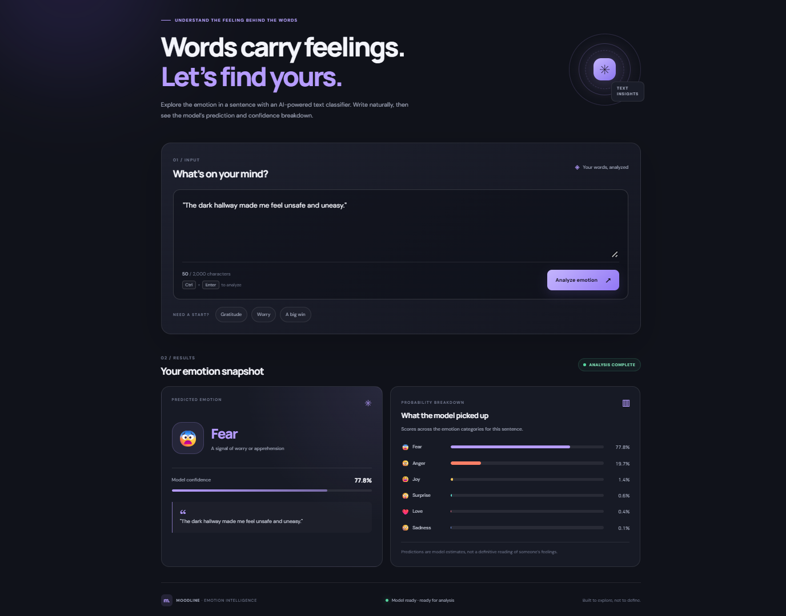

# 🧠 Moodline — Deep Learning Emotion Detection

<p align="center">
  
  
  
  
  
</p>

**Moodline** is a deep learning-based text emotion detection application that predicts the emotional tone of a sentence using a trained **Bidirectional Gated Recurrent Unit (BiGRU)** neural network. It combines natural language preprocessing, sequence modeling, and a FastAPI backend to deliver emotion predictions with confidence scores and class-wise probabilities through a web interface.

## 📸 Application Screenshots

## 🏠 Home Page

<p align="center">
  
</p>

## 🎯 Emotion Prediction

<p align="center">
  
</p>


## ✨ Features

- **Six-class emotion classification** — predicts sadness, joy, love, anger, fear, and surprise.
- **BiGRU deep learning model** — captures contextual information from text in both forward and backward directions.
- **Text preprocessing** — normalizes input text before tokenization.
- **Sequence padding** — converts tokenized sentences into fixed-length sequences of 50 tokens.
- **Confidence scoring** — returns the confidence associated with the predicted class.
- **Class-wise probabilities** — provides probability scores for all six emotion categories.
- **FastAPI backend** — exposes REST endpoints for prediction and health checks.
- **Interactive web interface** — lets users submit text and view emotion predictions.

## 🛠️ Technology Stack

| Category | Technologies |
|---|---|
| Programming Language | Python |
| Deep Learning | TensorFlow, Keras |
| Neural Network | Bidirectional GRU (BiGRU) |
| NLP | Keras Tokenizer, text preprocessing, sequence padding |
| Backend | FastAPI |
| API Server | Uvicorn |
| Data Processing | NumPy |
| Serialization | Pickle |
| Frontend | HTML, CSS, JavaScript |

## 🧠 Model Architecture

Moodline uses a Bidirectional GRU architecture for text classification. The input sentence is tokenized and padded to a fixed sequence length before being passed to the trained model.

### Model pipeline

```text
Input Text
    │
    ▼
Text Preprocessing
    │
    ▼
Tokenizer
    │
    ▼
Sequence Padding (50 tokens)
    │
    ▼
Embedding Layer
    │
    ▼
Bidirectional GRU (128 units)
    │
    ▼
Dropout
    │
    ▼
Bidirectional GRU (64 units)
    │
    ▼
Dropout
    │
    ▼
Dense Layer + Softmax
    │
    ▼
Predicted Emotion + Probabilities
```

### Why BiGRU?

A Bidirectional GRU processes text in both forward and backward directions, allowing the model to learn contextual information from both sides of a sequence. The final Dense layer with softmax produces probability scores across the emotion classes.

### Supported emotions

| Emotion | Description |
|---|---|
| 😢 Sadness | Text expressing sadness or disappointment |
| 😄 Joy | Text expressing happiness or excitement |
| ❤️ Love | Text expressing affection or care |
| 😠 Anger | Text expressing frustration or anger |
| 😨 Fear | Text expressing fear or anxiety |
| 😲 Surprise | Text expressing unexpected events or reactions |

## ⚙️ How It Works

1. The user enters a sentence in the web interface.
2. The frontend sends the text to the FastAPI `/predict` endpoint.
3. The backend converts the text to lowercase, removes apostrophes and special characters, and normalizes whitespace.
4. The saved tokenizer converts the cleaned text into integer sequences.
5. The sequence is padded or truncated to 50 tokens.
6. The trained BiGRU model calculates class probabilities.
7. The API returns the predicted emotion, confidence score, original input text, and probabilities for all six classes.
8. The frontend displays the prediction.

## 🚀 Getting Started

### Prerequisites

- Python 3.11 recommended for the pinned TensorFlow dependency
- pip
- Git

### 1. Clone the repository

```bash
git clone https://github.com/milan-7417/Emotion_detection-DL.git
cd Emotion_detection-DL
```

### 2. Create a virtual environment

**Windows (PowerShell)**

```powershell
python -m venv .venv
.venv\Scripts\Activate.ps1
```

**Linux / macOS**

```bash
python3 -m venv .venv
source .venv/bin/activate
```

### 3. Install dependencies

```bash
python -m pip install --upgrade pip
pip install -r requirements.txt
```

### 4. Verify model files

Ensure the trained model and tokenizer are present at these paths:

```text
Artifacts/
├── BiGRU_Model.keras
└── tokenizer.pkl
```

These files are required for inference. The application loads them when FastAPI starts.

### 5. Run the application

```bash
python -m uvicorn main:app --host 127.0.0.1 --port 8000 --reload
```

Open the application in your browser:

**Web interface:** http://127.0.0.1:8000/

**API documentation:** http://127.0.0.1:8000/docs

**Health check:** http://127.0.0.1:8000/health

> If your FastAPI file is not named `main.py`, update `main:app` in the command to match your filename and FastAPI application variable.

## 🔌 API Reference

### 1. Health Check

**Endpoint:** `GET /health`

Checks whether the server is running and whether the model and tokenizer have loaded.

Example response:

```json
{
  "status": "Server is running",
  "model_loaded": true
}
```

### 2. Predict Emotion

**Endpoint:** `POST /predict`

Request body:

```json
{
  "text": "I feel so happy and excited"
}
```

Example response structure:

```json
{
  "text": "I feel so happy and excited",
  "predicted_emotion": "joy",
  "confidence": 0.95,
  "all_probabilites": {
    "sadness": 0.01,
    "joy": 0.95,
    "love": 0.02,
    "anger": 0.005,
    "fear": 0.005,
    "surprise": 0.01
  }
}
```

*The probability values above are illustrative examples, not measured results from the trained model.*

The API uses `all_probabilites` as the response field name to match the current implementation.

## 📁 Project Structure

```text
Emotion_detection-DL/
│
├── Artifacts/
│   ├── BiGRU_Model.keras
│   └── tokenizer.pkl
│
├── snaps/
│   ├── home(2).png
│   └── prediction.png
│
├── static/
│   ├── index.html
│   ├── style.css
│   └── script.js
│
├── main.py
├── requirements.txt
├── .gitignore
└── README.md
```

*This structure reflects the application files discussed for Moodline. Adjust it if your actual repository contains additional files or different names.*

## 🔒 Input Validation and Error Handling

The API validates text input using Pydantic:

- Text must contain at least one character.
- Text length is limited to 2,000 characters.
- The prediction endpoint returns HTTP 503 if the model or tokenizer has not loaded.

The current preprocessing implementation is designed for English text and removes characters outside the English letters, digits, and whitespace.


## ⚠️ Limitations

- The model predicts one of six predefined emotion categories.
- Predictions depend on the training data and learned patterns.
- Confidence scores should not be interpreted as guaranteed probabilities of a person's true emotional state.
- The application is intended for educational and experimental use, not as a substitute for professional psychological assessment.

## 👨‍💻 Author

**Milan**


## 📄 License

No license is specified here. Add a `LICENSE` file if you intend to publish the project with explicit permissions for reuse and distribution.
